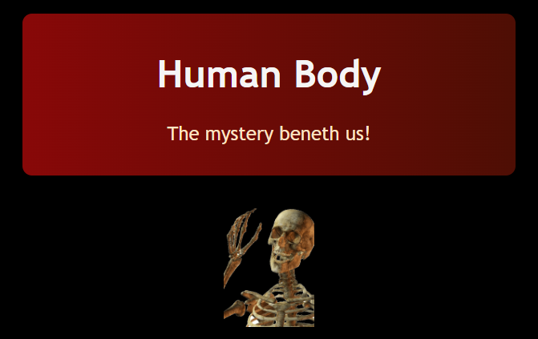

# Human body
Have you ever been amazed about how our body works?? Maybeee?? But surely yes for me. For people like me, I have created this website about basic biolody of the human body.

# Tech Used
1. HTML
2. CSS

# Preview

# Topics Covered
1. Circulatory System
2. Respiratory System
3. Digestive and Excretory System
4. Skeletal System
5. Muscular System
6. Nevous System

# Skills leared
1. styling different pages with only one css file
2. linear gradient colour

# Feature
1. Color Theme - like blood(different shades of red) and black and a kind of peach color which represents skin colour.
2. Good content 

# Credits
The content of the website is taken from wikipedia. Sooo, thanks wikipedia!!! (Be generoush :D)... And also my brain ofc XD.......

